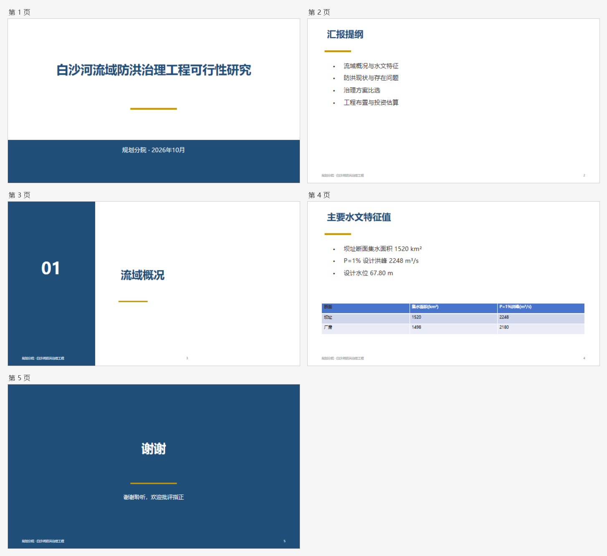

# wps-office-cooperate

在 WPS 里**实时**改 Office 文档的 skill：用户开着窗口，agent 通过 COM 直接改同一份活文档，所有改动当场可见。

- **Word（WPS Writer，`KWPS.Application`）**：修订模式逐段改写（可逐条接受/拒绝）、批注、页面渲染核对、排版、表格/题注/图片/目录/参考文献、快照对比、undo、交接单；**表格批量整理**：`table -Action scan`（体检：题名在框内/跨页没表头/边框粗细）、`-Action caption`（题名提到框外并删该行）、`-Action header-repeat`（跨页表头，自动迭代收敛）、`-Action rows`（删行），全部绕过 WPS 残缺的 `Rows.Item(n)` 对象；**单位上标批量修**：`unit -Apply` 把掉下来的 `m3/s`、`km2`、`万m3` 改成 `m³/s`、`km²`，已正确的两种上标形态（Unicode、run 级）与 `item3`/`m23` 类形态自动跳过，300 页实测 ~21 s。
- **Excel（WPS 表格，`KET.Application`）**：批量写值/公式（锚点校验、原子批、失败回滚）、整列 fill、单元格批注、区域渲染、快照/对比/一键回滚、图表、行列表结构编辑。
- **PPT（WPS 演示，`KWPP.Application`）**：`theme` 整稿风格打底（主色/字体/页脚/页码，深色底自动白字）、预设版式建页（封面/章节/要点/两栏/结束，真项目符号）、形状级锚定改文字、**`replace` 全稿查找替换**（正文/组合/表格单元格/备注/页脚，写入前 `Characters()` 回读校验、保证字号字体颜色不掉、自动 `prereplace` 快照可一键回滚）、**`split`/`merge` 拆分册与合并多稿**（区间必须连续覆盖全稿、拆分走整份复制故设计母版不丢、每页保留原版式）、**`master` 版式/页脚/套外来模板**（批量页脚页码日期、按旧常量批量换版式、`rebase` 以外来模板为底把本稿页搬进去）、**`picture` 全稿换图/换 logo**（先 list 看清几何与链接状态，replace 沿用原几何、链接图直接换源、组合内的图明确跳过）、**`comment` 批注**（批量落校审意见、`@形状名` 锚定、失败整批回滚）、**`export` 交付导出**（PDF/PNG/JPG/markdown，PNG 走剪贴板故为明文、PDF 落盘是密文会在返回里标明）、**`chart` 原生可编辑图表**（数据经内嵌工作簿写入，读者可就地改数；WPS 限制：必须 `-Show` 开窗口、只收字面值、点数靠增删行对齐）、**`check` 交付前门禁**（11 条规则分级 blocker/major/minor、`-ExitCode` 可当 CI 门、误报用 `-Config` 白名单抑制且单列不隐藏）、**`outline` 导出大纲**（标题+要点+备注，给"AI 写讲稿"供料）、表格/图片/文本框/色块、演讲备注、`audit` 机械体检（溢出/字号/越界/重叠/空页）、`align`/`zorder` 收拾版式、`render` 单页与 `-Overview` 六页拼图、文本快照 `diff`/`restore`；`open` 不存在的路径即新建演示文稿。

v1.0 由 `wps-word-cooperate`（v0.8）与 `wps-excel-cooperate`（v0.6）于 2026-10-25 合并而成。原 Word 版曾托管在合集 [my-doc-skills](https://github.com/freeskychenjun/my-doc-skills)，合并后该目录已移除，此处为唯一维护位置。

## 效果

一份用预设版式 + 主题一次生成的汇报稿（`render -Overview` 六页拼图，带页码），全部改动都发生在 WPS 窗口里：



Word 侧的修订与表格效果：

| 修订模式改写 | 表格与版式 |
|---|---|
|  |  |

## 入口

```
powershell -NoProfile -ExecutionPolicy Bypass -File <skill>\scripts\office.ps1 word|excel|ppt <命令> [参数]
```

`word.ps1` / `excel.ps1` / `ppt.ps1` 也可直接调用。输出一段 JSON：`{"ok":true,"result":{...}}` 或 `{"ok":false,"error":{"code":"...","message":"..."}}`。

环境：Windows + WPS（没装微软 Office 也行）。首次调用用系统 `csc.exe` 编译 helper（约 1 秒，按源码哈希缓存）。

## 目录

```
SKILL.md               唯一权威说明（速查 + 铁律）
scripts/office.ps1     app 分发入口（word|excel|ppt）
scripts/word.ps1       Word 入口（原 wps.ps1）
scripts/excel.ps1      Excel 入口（原 et.ps1）
scripts/helper/word/   Word helper C# 源码（编译缓存按哈希）
scripts/helper/excel/  Excel helper C# 源码
reference/             workflows / quirks / encryption / acceptance
publish.ps1            发布到部署目录（不带 tests/docs/tools）
```

## 发布

```
.\publish.ps1            # 部署到 C:\Users\<user>\.agents\skills\wps-office-cooperate
.\publish.ps1 -Target d  # 部署到别处
```

## 开发

- helper 是纯 C#5 单/多文件，改完直接跑 `word.ps1 status` / `excel.ps1 doctor`，源码哈希变了自动重编。
- 测试基线在 `tests/word`（验收脚本 + 语料）、`tests/excel/work`、`tests/ppt`：
  - `run_replace.ps1` —— `replace` 的 12 个场景（断言在 `check.py`，期望值由 python-pptx 独立算出，fixture 见 `make_deck.py`）；
  - `run_check.ps1` —— `check`/`outline` 的规则级断言（`check_check.py`；fixture 每页只埋一个缺陷、另留干净页专门验"不误报"）；
  - `run_deliver.ps1` —— `comment`/`export`/`picture` 的断言（`check_deliver.py`）；
  - `run_chapters.ps1` —— `split`/`merge` 的断言（`check_chapters.py`；每页有独立标题，顺序和丢页都查得出来；母版标记验"设计是否跟着拆出来"）；
  - `run_master.ps1` —— `master` 的 list/footer/layout/rebase 断言（`check_master.py`；模板稿带 `TPL-MARK` 母版标记，验 rebase 后内容确实穿上了模板）。
  - `local.config.json`（不提交）放本机的解密工具路径：**中文路径不能写进 .ps1**，PS 5.1 会按 ANSI 读成乱码。
- 版本历史：[reference/word-acceptance.md](reference/word-acceptance.md)、[reference/excel-acceptance.md](reference/excel-acceptance.md)。
