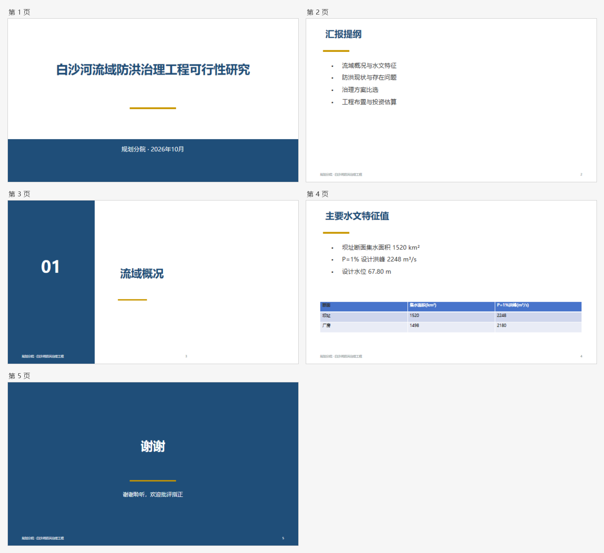
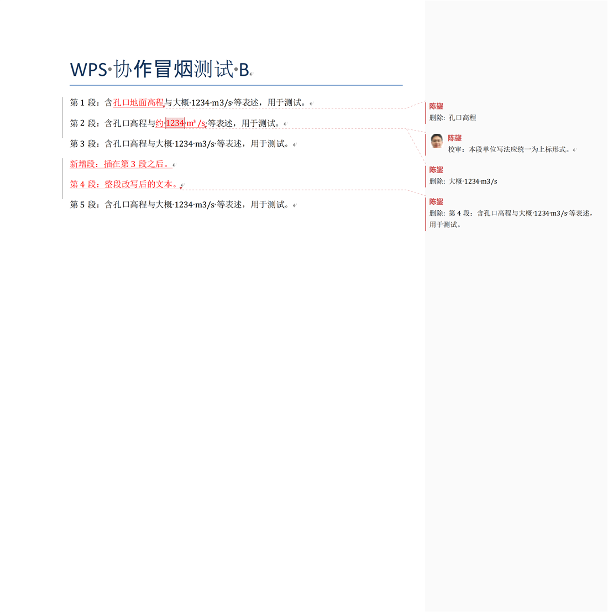
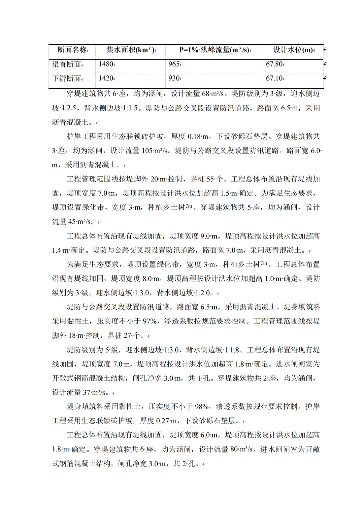

# wps-office-cooperate

在 WPS 里**实时**改 Office 文档的 skill：用户开着窗口，agent 通过 COM 直接改同一份活文档，所有改动当场可见。

- **Word（WPS Writer，`KWPS.Application`）**：修订模式逐段改写（可逐条接受/拒绝）、批注、页面渲染核对、排版、表格/题注/图片/目录/参考文献、快照对比、undo、交接单；**表格编号体检 `captions`**：一条只读命令把每张表与它的题注配对，给出重号/同节跳号/表号格式混用（`2.4.1` vs `3.3-1`）/题注位置混用（表内第 1 行 vs 表外上方）/表号与题名之间空格不一/缺题注/正文悬空引用（10521 段 / 32 表的真实报告 **6.4 s**，此前只能 22 次 `read` 全扫 4.5 min）；**表格一键整备 `table -Action plan|normalize`**（v1.33：plan 一条只读命令给全 14 表结构/题注页码/边框/列宽/风险清单，normalize 只改未达标表——题注外提、空白规范化、加粗边框、跨页表头；同一份 14 表报告从 127 次调用 / 88.6 min 压到 **7 条命令 ≈44 s**），另有 `render -Table n` 只渲该表所跨页；**原生公式 `formula`**（LaTeX → 真 OMML，Flat OPC + `Range.InsertXML`，插后校验 `OMaths.Count` 否则回滚）、**原生脚注 `footnote`**（list/insert/edit/delete/numbering）、**`render -Overview` 联系表总览图**（6 页/张）、**`fillgaps` 填掉图表前的页面留白**；**单位上标批量修**：`unit -Apply` 把掉下来的 `m3/s`、`km2`、`万m3` 改成 `m³/s`、`km²`，已正确的两种上标形态（Unicode、run 级）与 `item3`/`m23` 类形态自动跳过，300 页实测 ~21 s。
- **Excel（WPS 表格，`KET.Application`）**：批量写值/公式（锚点校验、原子批、失败回滚）、整列 fill、单元格批注、区域渲染（`-IncludeCharts` 连图表一起出图、出图前后自动保存/恢复用户剪贴板）、快照/对比/**一键回滚**（`restore` 支持 `-Cells` 选择性回滚）、原生图表（组合图+次坐标轴、占用区域与重叠提示）、行列表结构编辑、`new` 新建工作簿；**数据操作层（v1.29）**：`read -Profile` 概况（LOOK 段 + 日期识别 + 错误码）、`clean`（`¥1,299`/`89元`/`10%`→数字、七种日期写法→日期）、`fillblanks`、`dedupe`、`deletewhere`、`sort`、`filter`、`copy`、`addcol`、`pivot`（结果直接回读；v1.31 起按月/季/年分组实测可用）、`freeze`、`cformat`、`validate`、`table`；`replace` 走**内存块替换**（v1.31：绝不用 `Range.Replace`——WPS 会二次替换成 `P--`）。
- **PPT（WPS 演示，`KWPP.Application`）**：`theme` 整稿风格打底（主色/字体/页脚/页码，深色底自动白字）、预设版式建页（封面/章节/要点/两栏/结束，真项目符号）、形状级锚定改文字、**`replace` 全稿查找替换**（正文/组合/表格单元格/备注/页脚，写入前 `Characters()` 回读校验、保证字号字体颜色不掉、自动 `prereplace` 快照可一键回滚）、**`split`/`merge` 拆分册与合并多稿**（区间必须连续覆盖全稿、拆分走整份复制故设计母版不丢、每页保留原版式）、**`master` 版式/页脚/套外来模板**（批量页脚页码日期、按旧常量批量换版式、`rebase` 以外来模板为底把本稿页搬进去）、**`picture` 全稿换图/换 logo**（先 list 看清几何与链接状态，replace 沿用原几何、链接图直接换源、组合内的图明确跳过）、**`comment` 批注**（批量落校审意见、`@形状名` 锚定、失败整批回滚）、**`export` 交付导出**（PDF/PNG/JPG/markdown，PNG 走剪贴板故为明文、PDF 落盘是密文会在返回里标明）、**`chart` 原生可编辑图表**（数据经内嵌工作簿写入，读者可就地改数；WPS 限制：必须 `-Show` 开窗口、只收字面值、点数靠增删行对齐）、**`check` 交付前门禁**（11 条规则分级 blocker/major/minor、`-ExitCode` 可当 CI 门、误报用 `-Config` 白名单抑制且单列不隐藏）、**`outline` 导出大纲**（标题+要点+备注，给"AI 写讲稿"供料）、表格/图片/文本框/色块、演讲备注、`audit` 机械体检（溢出/字号/越界/重叠/空页）、`align`/`zorder` 收拾版式、`render` 单页与 `-Overview` 六页拼图、文本快照 `diff`/`restore`；**成品版式层**（v1.31 起 8 档 `cards`/`stats`/`timeline`/`process`/`compare`/`summary`/`gallery`/`split`，v1.32 再加 `canvas` 自由版面 / `grid` 结构化版面 / `slide -Action reuse` 复用页；另有形状绘制图表 scatter/curve/pie/doughnut、`crop` 套版裁切（GDI+ 预裁，不碰 `PictureFormat.Crop*`）、`connect` 框图连线、`smartart`、`bg` 背景纹理、`anim` 切换动画——**每档字段契约与示例 JSON 见 [reference/ppt-presets.md](reference/ppt-presets.md)**）；`open` 不存在的路径即新建演示文稿。

**常驻提示（v1.12）**：`hint -Doc <路径> -Tray` 在系统托盘挂一个橙色「AI」图标——悬停显示「〔AI接管中〕 文档名 · 当前步骤」，右键可「结束协作：还原标题标记」；`finish` / `close` 自动移除。Windows 会把新图标默认收进「^」溢出区（无法自我提升），拖到任务栏一次即可常显。

**接管提示（v1.11，三个 app 通用）**：agent 接手的瞬间用户就能看见——`open` 自动给窗口标签打上「〔AI接管中〕」标记（`〔AI接管中〕 报告.docx`，WPS 12 的标签页从右截断，所以标记放前面），`hint -Doc <路径> -Toast` 弹一句"已接管《X》：改动以修订/批注呈现，随时可接受或拒绝"，`hint -Text` 还能把当前进度写到状态栏（表格实测可见；Writer 只接受写入、界面不渲染）；收尾 `finish` / `close` 自动还原标题与状态栏。**全部是窗口状态：不进修订、不写文档、不落盘**。PPT 侧有三个通道（都是窗口/内容标记，不是文档内容）：① **窗口标题标记**（v1.26，`PP12FrameClass` + `SetWindowText`，任务栏/Alt+Tab 看得见，COM 的 `captionSupported:false` 只代表"COM 标题不可写"）；② **托盘气泡/图标**（v1.11/v1.12）；③ **按需的逐页药丸**（v1.27 引入、v1.28 改 opt-in）：`hint -SlideMark` 才在每页右上角贴「〔AI接管中〕」，它是**内容**（用户 Ctrl+S 会存进文件，故默认不贴；落盘前自动剥离，被存进去由下一条命令自动修复并返回 `badgeRepaired:true`）。

**标记是租约（v1.35；v1.36 过期即退出 + 卡死窗口自愈）**：接管标记不再需要 agent 主动收尾——常驻 helper 每条命令续租，**AI 静默超过 `WOC_HINT_LEASE_MS`（默认 120 s）** 就自动还原所有仍挂着的标记（Word/Excel 标题与状态栏、PPT 标题前缀与页面药丸、托盘图标），**随后 helper 进程直接退出（v1.36）**，`serve -Action stop` 也会先还原再退；**用户退出 AI 会话后不会长期顶着「〔AI接管中〕」，也不会留下自动化客户端干扰用户自己保存/关闭**。只清"看得见的标记"、不清"接管意图"：AI 恢复发命令时下一条命令自动补标；`finish`/`close`/`hint -Clear` 才是结束协作（清意图，之后不再补标）。另外 **WPS 自己的关闭路径偶尔崩溃后会把文档窗口藏起来**（外框还在、内容全灰 = 用户说的"卡死"）：v1.36 每条命令执行前自检，发现 `Application.Visible=false` 且有文档就自动显示并激活，**发任意一条命令即可恢复**。

**空闲不留 COM 客户端（v1.38，修"关闭慢 + 空白窗口"的真因）**：用户实测"被 Agent 接管后关 Excel 要十几秒，还留一个空白 WPS 窗口，得再点一下才退"，而不接管时瞬间关。定位实验（双击副本 → 关窗口 → 点"不保存"）：不接管 **670 ms** 帧消失；接管且 helper 在世 **≥25 s 帧不消失、只剩空白**；接管后先 `serve -Action stop`（helper 释放 COM 并退出）→ **714 ms**。⇒ 根因是**常驻 helper 一直持有 WPS 的 `Application` COM 引用，WPS 自己的退出流程被卡住**（与标题标记文字无关，v1.37 开着 hint-off 也照样慢）。现在每条命令处理完就 `ReleaseComObject(_app)` + 置空 + GC（下条命令再 attach），daemon 与管道照常常驻：用户自己保存/关闭时 WPS 手里没有我们的客户端。修复后接管场景关闭 **727 ms**，与不接管同级。

**想验证"卡死是不是标记造成的"（v1.37）**：设 `WOC_HINT_OFF=1` 或建空文件 `%LOCALAPPDATA%\wps-office-cooperate\hint-off.txt`，三端就**只在文档内容区读写，完全不碰 WPS 的窗口标题/状态栏/可见性**（连自愈也停），读写命令照常可用；去掉即恢复。再设 `WOC_TRACE=1`（或 `trace-on.txt`）可把每次"写窗口/撤标记/自愈"记进 `trace-<app>.log`（毫秒时间戳）。实测对照：**零 helper 进程时双击打开 xlsx 也会让 `wps.exe` 崩在 `kprometheus.dll_unloaded`**（WPS 自身打开交接缺陷）；带标记关闭/撤标记实测 30–687 ms、0 崩溃——所以"关闭慢/重开空白"更可能来自 WPS 自身 + 脏文档关闭被晾住造成的僵尸窗口（`workbooks:[]` 但窗口还显示文件名 ⇒ 结束 `wps.exe` 重开）。

v1.0 由 `wps-word-cooperate`（v0.8）与 `wps-excel-cooperate`（v0.6）于 2026-10-25 合并而成。原 Word 版曾托管在合集 [my-doc-skills](https://github.com/freeskychenjun/my-doc-skills)，合并后该目录已移除，此处为唯一维护位置。## 效果

一份用预设版式 + 主题一次生成的汇报稿（`render -Overview` 六页拼图，带页码），全部改动都发生在 WPS 窗口里：



Word 侧的修订与表格效果：

| 修订模式改写 | 表格与版式 |
|---|---|
|  |  |

## 入口

```
powershell -NoProfile -ExecutionPolicy Bypass -File <skill>\scripts\office.ps1 word|excel|ppt <命令> [参数]
```

`word.ps1` / `excel.ps1` / `ppt.ps1` 也可直接调用。输出一段 JSON：`{"ok":true,"result":{...}}` 或 `{"ok":false,"error":{"code":"...","message":"..."}}`。

**多任务（v1.20）**：一个会话里可同时布置「多章节 / 同章多任务 / 章节 + 全文任务」——子代理并行规划（零 COM），`scripts/tasks.ps1` 按段合并后，父代理作为唯一写者按「表格 → 文本批 → 格式 → unit → 批注」顺序提交（多章节从后往前）。见 [reference/multi-task.md](reference/multi-task.md)。

环境：Windows + WPS（没装微软 Office 也行）。首次调用用系统 `csc.exe` 编译 helper（约 1 秒，按源码哈希缓存）。

## 目录

```
SKILL.md               唯一权威说明（速查 + 铁律）
scripts/office.ps1     app 分发入口（word|excel|ppt）
scripts/word.ps1       Word 入口（原 wps.ps1）
scripts/excel.ps1      Excel 入口（原 et.ps1）
scripts/tasks.ps1      多任务协作辅助：split / merge / plan / selftest（并行规划、合并写回）
scripts/helper/word/   Word helper C# 源码（编译缓存按哈希）
scripts/helper/excel/  Excel helper C# 源码
reference/             workflows / multi-task / quirks / presets / changelog / encryption / acceptance
tests/                 回归测试（run_all.ps1 两层 runner；不随包分发）
publish.ps1            发布到部署目录（不带 tests/docs/tools）
```

## 发布

```
.\publish.ps1 -WhatIf     # 干跑：列出会复制/会被清理的文件，不动磁盘
.\publish.ps1            # 部署到 C:\Users\<user>\.agents\skills\wps-office-cooperate
.\publish.ps1 -Target d  # 部署到别处（父目录不是 skills 时需 -Force）
```

- 目标必须是 `…\skills\<name>` 形状（否则拒绝，`-Force` 显式放行）——脚本会递归清理目标里不属于包的文件，这条护栏防误传目录。
- 先 stage 到 `<target>.__staging` 再整体切换，中途失败不会留下半新半旧的部署。
- **新增要分发的 reference\* 文件必须登记到 `publish.ps1` 的 `$includes`**，否则部署目录缺文件（v1.34 新登记 `reference\ppt-presets.md`）。
- 发版五处同步（frontmatter `version` / SKILL.md 当前版本小节 / changelog 首条 / README / commit）见 [docs/release-checklist.md](docs/release-checklist.md)（仓库内，不随包分发）。

## 开发

- helper 是纯 C#5 单/多文件，改完直接跑 `word.ps1 status` / `excel.ps1 doctor`，源码哈希变了自动重编。
- **一条命令跑全部测试**：`tests\run_all.ps1`（`-SkipWps` = 只跑 fast 层，无需 WPS，CI 用）、`tests\run_all.ps1 -Layer wps`（三端真实 WPS 驱动器）；依赖与环境要求见 `tests\README.md`。
- `.ps1` 一律纯 ASCII + UTF-8 with BOM：`tests\check_encoding.ps1` 是编码门禁（fast 层会跑），防止 PS 5.1 按 ANSI 读中文出乱码。
- 测试基线在 `tests/word`（验收脚本 + 语料）、`tests/excel`（数据层回归 + 夹具生成器）、`tests/ppt`：
  - `tests/word/captions/check_captions.py` —— **表格编号体检的回归**（30 条断言）：`make_fixture.py` 生成 20 表 / 19 题注的语料（埋重号、跳号、格式混用、悬空引用、表后紧跟正文、缺题注），断言 `captions` 的清单与六类缺陷、`read` 的 `inTable` 边界与 `-SkipTableCells`、`scan.para`、`search` 段号校验与命中偏移；跑法 `python check_captions.py --verbose`；
  - `tests/word/check_normalize.py` —— **表格整备（plan/normalize）的回归**（A1–A9，`--static-only` 纯静态档 + 端到端档，夹具由 `make_normalize_fixture.py` 自给）；
  - `tests/excel/run_data.ps1` —— Excel 数据层回归（fill/chart/sort/deletewhere/fillblanks/table/sheet/replace/rows/cols，断言用 openpyxl 独立读回）；
  - `run_replace.ps1` —— `replace` 的 12 个场景（断言在 `check.py`，期望值由 python-pptx 独立算出，fixture 见 `make_deck.py`）；
  - `run_check.ps1` —— `check`/`outline` 的规则级断言（`check_check.py`；fixture 每页只埋一个缺陷、另留干净页专门验"不误报"）；
  - `run_deliver.ps1` —— `comment`/`export`/`picture` 的断言（`check_deliver.py`）；
  - `run_chapters.ps1` —— `split`/`merge` 的断言（`check_chapters.py`；每页有独立标题，顺序和丢页都查得出来；母版标记验"设计是否跟着拆出来"）；
  - `run_master.ps1` —— `master` 的 list/footer/layout/rebase 断言（`check_master.py`；模板稿带 `TPL-MARK` 母版标记，验 rebase 后内容确实穿上了模板）。
  - `local.config.json`（不提交）放本机的解密工具路径：**中文路径不能写进 .ps1**，PS 5.1 会按 ANSI 读成乱码。
- **版本历史只有一个出处**：[reference/changelog.md](reference/changelog.md)（v1.1 至今）；[reference/word-acceptance.md](reference/word-acceptance.md) / [reference/excel-acceptance.md](reference/excel-acceptance.md) 只记各版本验收记录。
